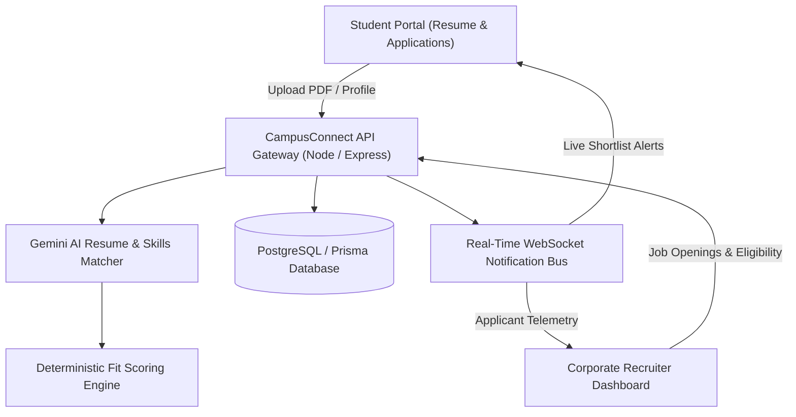

# 🎓 CampusConnect — Automated Campus Placement & Corporate Recruitment Ecosystem
### *Enterprise Placement Governance with Bi-Directional WebSockets, Gemini AI Resume Screening & Multi-Channel Interview Pipelines*

    [-3ECF8E?style=for-the-badge&logo=supabase&logoColor=white)](#)  

  <a href="https://github.com/Tharun4743/CampusConnect">📦 <b>Official GitHub Repository</b></a>
  • <a href="https://campusconnect-yg4h.onrender.com">🌐 <b>Production Live Demo</b></a>

---

## 1. 📌 Problem Statement & Context
### 🚨 The Recruitment Season Coordination Crisis

During university campus recruitment drives, placement coordination between students, Training & Placement Officers (TPOs), and visiting corporate recruiters becomes chaotic:

* 📑 **Manual Eligibility Verification Nightmare:** TPOs spend hundreds of hours manually verifying candidate eligibility (minimum CGPA cutoffs, department restrictions, active backlog counts) against outdated, error-prone spreadsheets.
* ⏳ **Opaque Application Pipelines:** Students have zero real-time visibility into their application journey. Applicants constantly message coordinators to learn if their resumes were shortlisted or when interview rounds are scheduled.
* 📂 **Disorganized Resume Archives:** Students upload unformatted, unverified CVs in disparate formats (Word, PDF, Drive links) that frequently expire or break during corporate HR reviews.
* 📢 **Severe Communication Lag:** Vital interview reschedule notices or venue changes sent via broadcast emails or message groups result in candidates missing corporate interviews.

---

## 2. 🔍 Existing Solutions & Critical Gaps
### 🔍 Comparison with Existing Job Platforms

| Feature / Metric | Commercial Job Portals (Naukri / LinkedIn) | Traditional Spreadsheets & Email | 🎓 CampusConnect |
| :--- | :---: | :---: | :---: |
| **College Role Separation** | ❌ Student/Recruiter Only | ❌ None | ✅ 4 Distinct Roles (Student, TPO, HR, Admin) |
| **Automated Backlog / CGPA Gates** | ❌ Unverified Self-Reported | ⚠️ Manual Formula Auditing | ✅ Strict Database Guardrails |
| **Real-Time WebSocket Pipeline** | ❌ Page Refresh Required | ❌ None | ✅ Live Bi-Directional Socket.IO Updates |
| **AI Resume Evaluation** | ⚠️ Generic Keyword Scoring | ❌ None | ✅ Google Gemini AI Skill-Gap Analysis |
| **Cloud Document Vault** | ⚠️ Unverified File Hosting | ⚠️ Broken Drive Permissions | ✅ Secure Cloudinary CDN with Validation |
| **Transactional Email Failover** | ⚠️ Single Provider | ❌ Manual Gmail Sends | ✅ Resend / SendGrid / SMTP Triple Failover |

---

## 3. 💡 Proposed Solution & Architectural Innovation
### 💡 The CampusConnect Unified Ecosystem

**CampusConnect** is a comprehensive, production-grade placement platform unifying Students, TPO Officers, Corporate Recruiters, and Platform Administrators into a single cohesive operational workflow:

* 📂 **Interactive Cloudinary Document Vault:** Secure repository hosting academic transcripts, verified resumes, and certifications with zero broken links and automated compression.
* 🤖 **Google Gemini AI Resume Intelligence:** Deep semantic analysis matching candidate resumes against posted job descriptions, generating contextual fit scores and actionable skill gap recommendations.
* ⚡ **Live WebSocket Application Funnel:** Bi-directional Socket.IO integration delivering instantaneous visual timeline transitions across five states: Applied → Shortlisted → Interviewing → Offered → Rejected.
* 💼 **Corporate Recruiter Drive Suite:** HR leads can publish vacancies with strict automated eligibility gates (minimum CGPA, allowed branches, maximum active backlogs), filter student rosters instantaneously, schedule interview slots, and dispatch offer letters.
* 🛡️ **Hardened Enterprise Security:** Defense-in-depth architecture with HttpOnly JWT session tokens, Same-Origin CSRF validation, Helmet COOP customization, and proxy-aware API rate limiting.

---

## 4. ⚙️ Technical Approach & System Architecture

### 📐 High-Level Architectural Flowchart:

### ⚙️ Full-Stack System Architecture

| System Layer | Technology Stack | Operational Functionality |
| :--- | :--- | :--- |
| **Frontend SPA** | React 19, Vite 6.2, Tailwind CSS v4, React Router v7 | Responsive client portal, Framer Motion animations, reactive query caching |
| **Backend REST & WS** | Node.js 20+, Express, TypeScript (tsx), Socket.IO | High-concurrency RESTful API endpoints and bi-directional WebSocket event relays |
| **Database & Storage** | Supabase (PostgreSQL 15), Cloudinary API | Relational schema with foreign key integrity; secure cloud CDN for student PDF CVs |
| **AI & Notification** | Google Gemini AI SDK, Resend, SendGrid, Nodemailer | Automated resume evaluation; multi-node failover transactional email dispatches |
| **Security Layer** | JWT (HttpOnly), Helmet COOP, Express Rate Limiting | Domain verification, proxy-aware abuse prevention, and CSRF defense |

#### End-to-End Recruitment Workflow:
1. **Job Drive Posting:** Recruiter posts job requirements → Defines CGPA/Backlog eligibility → System auto-screens student database.
2. **Candidate Application & AI Review:** Student applies with one click → Gemini AI evaluates CV alignment → TPO approves roster.
3. **Interview Progression:** Recruiter triggers interview slot → Student receives live WebSocket push + email alert → Status updates in real time.

---

## 5. 📈 Quantifiable Impact & Measurable Benefits
### 📈 Measurable Operational Benefits & Outcomes

* ⏱️ **70% Reduction in Drive Coordination Overhead:** Automated eligibility filtering saves TPOs dozens of hours of manual roster audits per campus drive.
* 🚀 **Zero Communication Lag:** Live WebSockets ensure 100% of shortlisted candidates receive interview timings and venue changes instantly.
* 🔍 **Sub-Second Candidate Screening:** Corporate recruiters filter hundreds of profiles by exact criteria in milliseconds.
* ☁️ **Turnkey Continuous Deployment:** Pre-configured with render.yaml infrastructure-as-code for zero-downtime automated deployment on push.

---

## 6. 🚀 Feasibility, Operational Viability & Scalability
### 🚀 Feasibility, Economics & Expansion Roadmap

* 🔬 **Technical Feasibility:** Successfully operating on Render with cloud PostgreSQL. Scalable client-server model handles heavy traffic bursts during placement season.
* 💰 **Economic Viability:** Replaces costly third-party commercial placement software costing thousands of dollars annually with an open-source, cost-effective infrastructure.
* 📈 **Scalability:** Easily extensible to support inter-collegiate placement pools, multi-campus university systems, and alumni referral programs.

---

## 7. 👨‍💻 Engineering Author

<table border="0">
  <tr>
    <td width="120" align="center" valign="top">
      
    </td>
    <td>
      <h3>Tharunkumar K</h3>
      

        <b>Full Stack Developer & AI Systems Engineer</b> 
        🎓 B.Tech in Information Technology — <a href="https://vsbec.com"><b>V.S.B. Engineering College, Karur</b></a> (Batch 2024–2028) 
        🌟 Recognized for holding the <b>Best GitHub Profile & Top Student Developer</b> at V.S.B. Engineering College (VSBEC) 
        🥇 <b>Winner — Code Thugs 2K26</b> • 🚀 <b>Smart India Hackathon (SIH)</b> Top 50 National Finalist
      

      

        <a href="https://tharunkumark4743.netlify.app/">🌐 Portfolio</a> •
        <a href="https://github.com/Tharun4743">🐙 GitHub (@Tharun4743)</a> •
        <a href="https://www.linkedin.com/in/tharunkumark4743">💼 LinkedIn</a> •
        <a href="https://leetcode.com/u/Tharunkumar__K/">🧩 LeetCode</a> •
        <a href="mailto:tharunkumark42007@gmail.com">📧 Email</a>
      

    </td>
  </tr>
</table>

<!-- =========================================================================
   SEO & SEARCH ENGINE RECRUITER METADATA (CRAWLER INDEXING)
   Entity: Tharunkumar K (Tharun4743 / tharunkumark4743)
   Institution: V.S.B. Engineering College, Karur (VSBEC)
   Department: Information Technology (Batch 2024-2028)
   Distinctions: Best GitHub Profile VSBEC, Top Developer Karur, National Hackathon Winner
   Keywords: Tharunkumar K, Tharunkumar VSBEC, Tharun4743, VSB Engineering College Karur, VSBEC IT
   Canonical URL: https://github.com/Tharun4743/CampusConnect
========================================================================= -->
