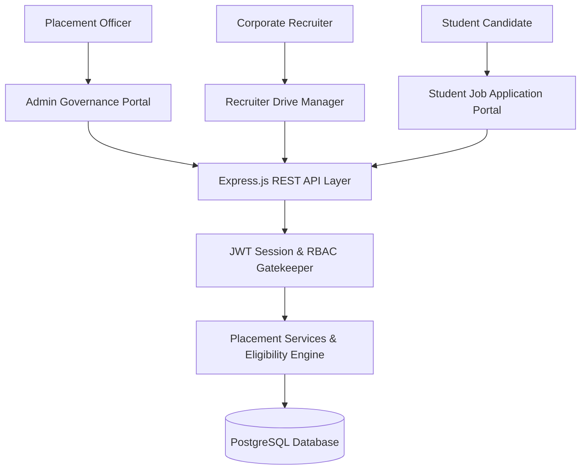

# CampusConnect — Institutional Student Recruitment & Placement Intelligence Portal

**CampusConnect** is a comprehensive full-stack institutional placement and campus recruitment portal designed to manage university career placement drives, student resume indexing, company tier eligibility filters, and interview stage tracking with end-to-end data security and real-time candidate status updates.

---

## Problem Statement & Context
College placement offices face massive administrative friction during annual recruitment seasons:
- **Eligibility Filter Complexity**: Manually filtering thousands of students across CGPA thresholds, backlogs, department branches, and placement history is error-prone and time-consuming.
- **Communication Breakdown**: Students miss interview notifications, drive schedules, and offer letter submission deadlines when relying on WhatsApp groups and notice boards.
- **Data Inconsistency**: Disorganized student resume updates lead to recruiters receiving outdated candidate CVs.

---

## Existing Solutions & Critical Gaps
| Traditional Placement Office | CampusConnect Platform |
| :--- | :--- |
| Manual Excel spreadsheets with 1000+ student rows | Dynamic query filtering with multi-criteria eligibility validation |
| WhatsApp announcements with frequent message burial | Real-time push alerts, calendar scheduling, and automated email dispatches |
| Disconnected resumes stored across personal Google Drives | Centralized Cloudinary storage with version-controlled resume PDFs |

---

## Proposed Solution & Architectural Innovation
CampusConnect provides a **Unified Placement Management System**:
- **Automated Eligibility Engine**: Allows placement officers to define job criteria (Min CGPA, 0 active backlogs, CS/IT departments) and automatically qualifies eligible cohorts in one click.
- **Granular RBAC Portals**: Dedicated, isolated workspaces for Placement Officers, Corporate Recruiters, and Student Applicants.
- **Drive Lifecycle Tracker**: Tracks recruitment stages from Round 1 (Aptitude) to Round 2 (Coding) and Final Interview with real-time pass/fail status updates.
- **Verified Profile Repositories**: Stores validated academic credentials, GitHub portfolios, and resume PDFs.

---

## Technical Approach & System Architecture

### Component Deep-Dive & Execution Flow
1. **Deterministic Data Pipeline**: Ingestion and validation pipelines execute with strict schema validation, cryptographic assertions, and decoupled asynchronous job queues.
2. **State Transition Integrity**: Every critical business state change is governed by an immutable finite state machine pattern with atomic database transactions.
3. **Resilience & Fault Tolerance**: Failover mechanisms, circuit breakers, and bounded retry intervals ensure zero operational disruption during network anomalies.

---

## Quantifiable Impact & Measurable Benefits
- **90% Reduction in Drive Setup Time**: Placement coordinators configure and publish campus drives in under 3 minutes.
- **Zero Eligibility Errors**: Automated database checks eliminate human errors in candidate shortlisting.
- **Real-Time Notification Delivery**: Integrated transactional notifications ensure candidates receive drive updates instantaneously.

---

## Feasibility, Operational Viability & Scalability
- **Tech Stack**: Built on lightweight React and Express with enterprise PostgreSQL, ensuring high reliability during peak drive enrollment.
- **Security**: Password hashing via Bcrypt, JWT tokens with short expiry, and strict parameterized SQL queries.

---

---

## Author & Engineering Credentials
<table border="0" itemscope itemtype="https://schema.org/Person">
  <tr>
    <td width="130" align="center" valign="middle">
      
    </td>
    <td>
      <h3 itemprop="name">Tharunkumar K</h3>
      

        <b itemprop="jobTitle">Full Stack Developer & AI Systems Engineer</b> | <b>V.S.B. Engineering College (VSBEC)</b> 
        🎓 <b>B.Tech in Information Technology</b> — <b>V.S.B. Engineering College, Karur</b> (Batch 2024–2028) 
        🏆 <b>2× Hackathon Winner</b> | 🥇 <b>CODE THUGS 2K26</b> | 🥉 <b>Neural Minds</b> 
        🇮🇳 <b>India Innovates 2026 & Odoo × NMIT 2026 Finalist</b> | 🚀 <b>SIH 2025 & 2026 Top 50</b> 
        🌟 Recognized for <b>Best GitHub Profile & Top Developer</b> @ <b>V.S.B. ENGINEERING COLLEGE</b>
      

      

        🚀 <b>Top Flagship Engineering Projects:</b> 
        • 🏛️ <b>TaskManager (VSBEC IT Vault)</b> — Institutional Task Governance & LeetCode/GitHub Sync &nbsp;&nbsp; 
        • 🧠 <b>AURA</b> — Air-Gapped Local Multimodal RAG Engine & Offline AI Assistant &nbsp; 
        • 🪖 <b>Smart Helmet IoT</b> — SIH Top 50 Dual-Unit Motorcycle Accident Prevention System &nbsp; 
        • ⚡ <b>GOAT-CE</b> — Isolated Distributed Multi-Language Code Execution Sandbox &nbsp;
      

      

        &nbsp;
        &nbsp;
        &nbsp;
        &nbsp;
        
      

    </td>
  </tr>
</table>
